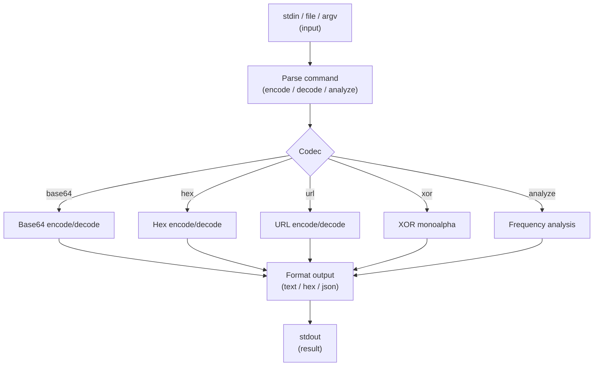

# ctf-codec-toolkit

Deterministic, offline encoding/decoding and character-frequency analysis for CTF and
offensive-security workflows — one small CLI with zero runtime dependencies.

[](https://github.com/forgeline-labs/ctf-codec-toolkit/actions/workflows/ci.yml)
[](LICENSE)
[](https://github.com/forgeline-labs/ctf-codec-toolkit/releases)

A terminal demo is scripted in [`docs/demo.tape`](docs/demo.tape) (for
[vhs](https://github.com/charmbracelet/vhs)). The generated GIF is optional for v0.1.0;
the tape is kept in the repository so the demo can be reproduced at any time.

## Architecture



## Quickstart

Requirements: Python 3.10+ and nothing else (standard library only).

```console
$ ./app encode base64 "test"
dGVzdA==

$ ./app decode base64 "dGVzdA=="
test

$ ./app analyze "aabbcc"
{"total_chars": 6, "unique_chars": 3, "histogram": [{"char": "a", "count": 2, "percentage": 33.3}, {"char": "b", "count": 2, "percentage": 33.3}, {"char": "c", "count": 2, "percentage": 33.3}]}
```

`./app` is a POSIX-executable Python script with a shebang; it works from the repository
root or from any directory.

## Usage

```
./app <COMMAND> [OPTIONS] [INPUT]
```

Input priority is `--input FILE` > `[INPUT]` > stdin. When no positional input is given,
raw bytes are read from stdin until EOF. Flags may appear before, between, or after the
command, codec, and input.

### Commands

| Command | Description |
|---|---|
| `encode <CODEC> [INPUT]` | Encode INPUT with CODEC. |
| `decode <CODEC> [INPUT]` | Decode INPUT with CODEC. |
| `analyze [INPUT]` | Print a JSON character-frequency report. |
| `help` | Print help on stdout, exit 0. |
| `version` | Print the version on stdout, exit 0. |

### Codecs

| Codec | Encode | Decode |
|---|---|---|
| `base64` | RFC 4648 standard alphabet, padded. | Padding optional; validates alphabet and padding. |
| `hex` | Continuous lowercase hex. | Case-insensitive; ignores ASCII whitespace; even digit count required. |
| `url` | RFC 3986 query-string percent encoding; space becomes `%20`. | Accepts `%HH` (any case) and `+` as space. |
| `xor:<HEX_KEY>` | XOR each byte with one byte given as two hex digits (`00`–`FF`). | Input is treated as hex when it contains only hex digits/whitespace, otherwise as UTF-8 text. |

### Flags

| Flag | Type | Default | Description |
|---|---|---|---|
| `--input FILE`, `-i FILE` | string | — | Read raw bytes from FILE instead of stdin/INPUT. |
| `--output FORMAT`, `-o FORMAT` | `text` \| `hex` | `text` for base64/url, `hex` for hex/xor | Output representation. |
| `--json` | flag | off | Emit one structured JSON document on stdout. `analyze` always emits JSON. |
| `--quiet` | flag | off | Suppress informational logs; the result is unchanged. |
| `--help`, `-h` | flag | — | Print help on stdout, exit 0. |
| `--version` | flag | — | Print `ctf-codec-toolkit 0.1.0` on stdout, exit 0. |

### Exit codes

| Code | Meaning |
|---|---|
| `0` | Success. |
| `1` | Validation/conversion failure (invalid Base64, odd hex, invalid UTF-8, malformed escape, …). |
| `2` | Usage or input-source error (unknown command/codec/flag, invalid XOR key, missing file, missing arguments). |
| `4` | Unexpected internal error. |

### Examples

```console
$ ./app encode hex "AB"
4142

$ ./app decode hex "41 42" --output text
AB

$ ./app encode url "hello world"
hello%20world

$ ./app decode url "hello+world"
hello world

$ ./app encode xor:42 "A"
03

$ ./app decode xor:42 "03" --output text
A

$ ./app encode base64 "test" --output hex
6447567a64413d3d

$ ./app decode base64 "dGVzdA==" --output hex
74657374

$ ./app encode base64 "test" --json
{"operation": "encode", "codec": "base64", "input_length": 4, "output": "dGVzdA==", "output_format": "text"}
```

JSON is compact, deterministic, and is the only thing written to stdout in `--json`
mode. The `analyze` histogram is sorted by count descending, then by character ascending.

## Supported codecs

- **Base64** — RFC 4648 standard alphabet `A-Za-z0-9+/`; output is padded, input padding
  is optional.
- **Hex** — lowercase output, case-insensitive input, whitespace ignored while decoding.
- **URL** — unreserved characters `A-Z a-z 0-9 - _ . ~` pass through; everything else is
  `%HH` (uppercase hex). Space encodes to `%20`, never `+`.
- **XOR** — single-byte key (`00`–`FF`), applied to every byte.
- **Frequency analysis** — counts each Unicode character, including control characters
  and multi-byte characters (an emoji counts as one character).

## Non-goals

This tool intentionally does **not** implement:

1. ROT13, Caesar, Vigenère, substitution, or transposition ciphers.
2. Padding oracles, side-channel attacks, or cryptography beyond single-byte XOR.
3. Steganography, visual steganalysis, or image/audio metadata extraction.
4. Networking, online decoders, or lookups against external databases.
5. A web interface, server, interactive TUI, or watch mode.
6. Compression, hashing, salting, or key derivation.
7. Databases, caches, or persistence beyond stdin/stdout/files.
8. Authentication, permissions, or process isolation.

## Examples

Ready-to-run sample inputs live in [`examples/`](examples/README.md):

- `examples/base64-example.txt`
- `examples/hex-example.txt`
- `examples/xor-example.txt`

## Testing

The public suite is black-box: it executes `./app` through subprocesses and checks
stdout, stderr, and exit codes.

```console
$ python -m pytest tests/
```

Lint (zero warnings required):

```console
$ ruff check src/ tests/
```

Both commands run fully offline and need only the standard library at runtime. `pytest`
and `ruff` are development tools and are the only packages installed by CI.

## How this was built

The specification for this repository was written first. The implementation was then
produced by an autonomous AI agent running in an internal harness, from that
specification alone, with no human editing of the code. The black-box acceptance tests
were written by a **different, independent AI agent** from the same specification; those
tests live outside this repository and are executed by the harness. Nothing here claims
human authorship of the code or of those acceptance tests.

Design decisions:

- **Offline-only.** No network calls, telemetry, or external services. Every result is
  reproducible on any machine with Python 3.10+.
- **Stable JSON schema.** `encode`/`decode` reports carry `operation`, `codec`,
  `input_length`, `output`, and `output_format`; `analyze` reports carry `total_chars`,
  `unique_chars`, and `histogram`. Field values and ordering are deterministic.
- **Determinism.** No timestamps, UUIDs, randomness, or locale-dependent formatting.
  Running the same command twice produces byte-identical stdout.
- **UTF-8 and binary support.** Input is read as raw bytes. Text output is emitted only
  when the bytes are valid UTF-8; otherwise the command exits `1`. Hex output is always
  available for arbitrary binary data.
- **Predictable exit codes.** `2` and `4` take precedence over `1`, and `1` over `0`.

## License

MIT © 2026 Gabriel Pinheiro. See [LICENSE](LICENSE).
